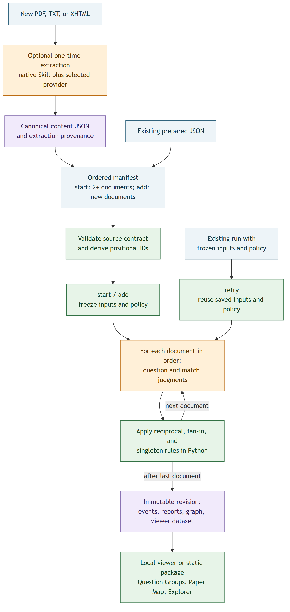
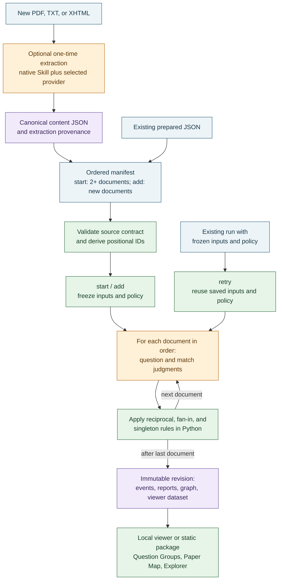
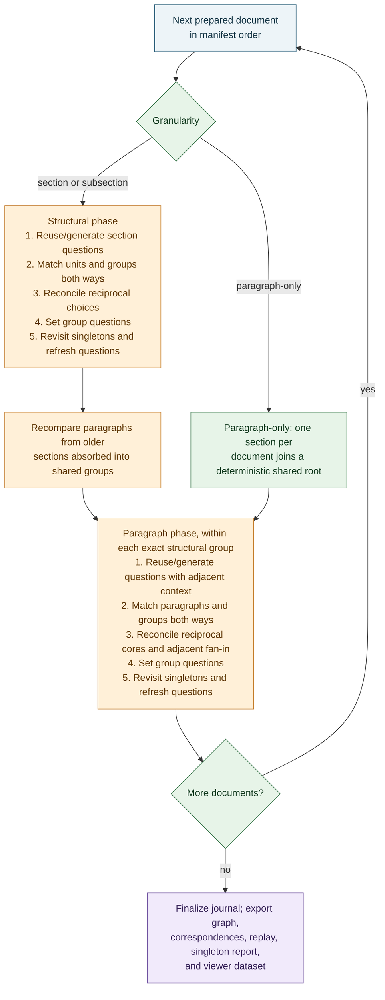

# Pipeline flow

The supported pipeline builds an ordered, question-role graph from canonical
documents. Extraction prepares a new source once; graph construction never
extracts it. Language models make bounded question and match judgments. Python
validates those judgments, applies graph rules, and writes inspectable outputs.
This is an SME-inspired comparison system, not the canonical symbolic SME.

## From source to viewer

`python -m pipeline.extraction` calls the extraction Skill for a new source,
validates the returned content, and refuses to overwrite an existing output.
`python -m pipeline.incremental_graph.cli validate` makes no model calls.
`start` creates a run from at least two documents; `add` appends only new
documents; `retry` takes no manifest and reuses saved inputs. Every execution
writes a new revision and replays the ordered sequence,
reusing completed judgments whose inputs and policy are unchanged. A failed
revision does not replace the last successful one. Viewer build, serving, and
packaging make no model calls.

## One document insertion

Orange stages mix model judgments and deterministic Python reconciliation;
the model is called only when a question is missing or a judgment is not
already in the run cache. Each match request selects one eligible
candidate or null; it does not return a batch of matches. Python accepts
reciprocal selections, applies the limited paragraph adjacency rule, and keeps
unaccepted selections as provenance. Structural singleton recovery can absorb
an older section. The runner then compares that section's existing paragraphs
inside their new shared scope before processing the incoming document's
paragraphs. Paragraph-only mode skips structural model judgments but still
runs paragraph recovery.

See [architecture](docs/architecture.md) for the exact rules and
[data contracts](docs/data-contracts.md) for input and output schemas. The
[README](README.md) gives commands for a first run and a new corpus.
