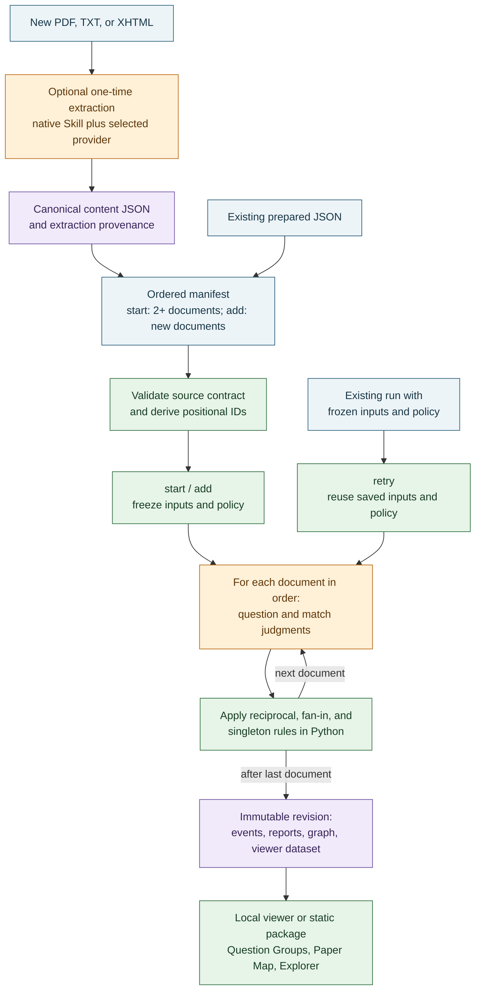
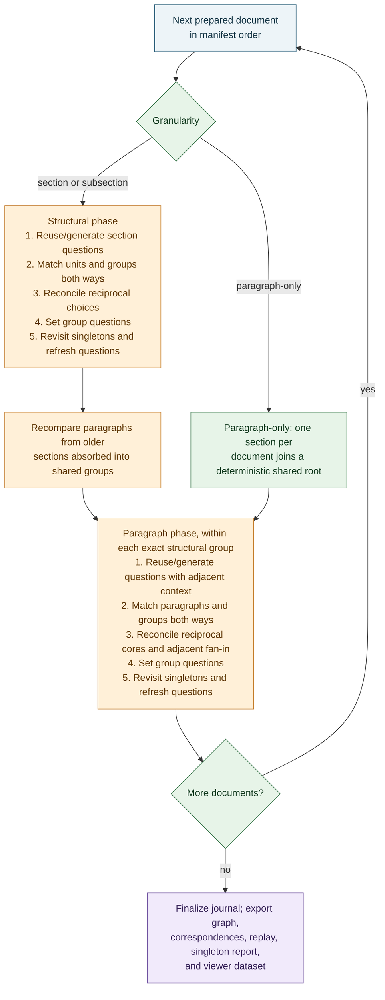
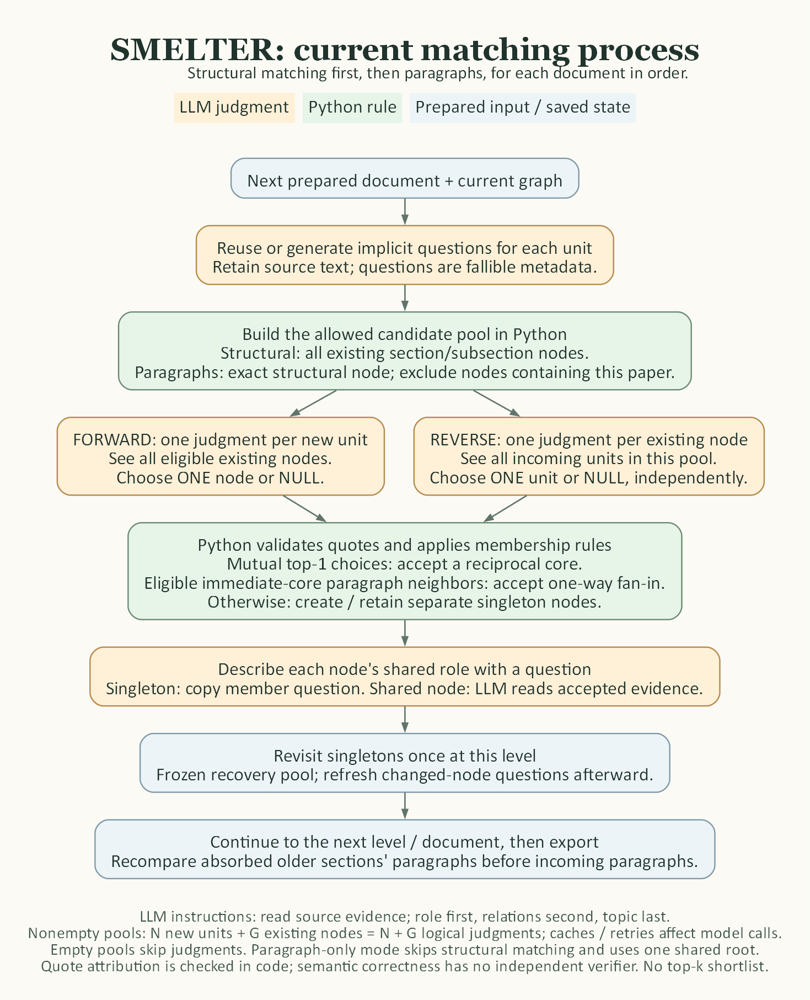
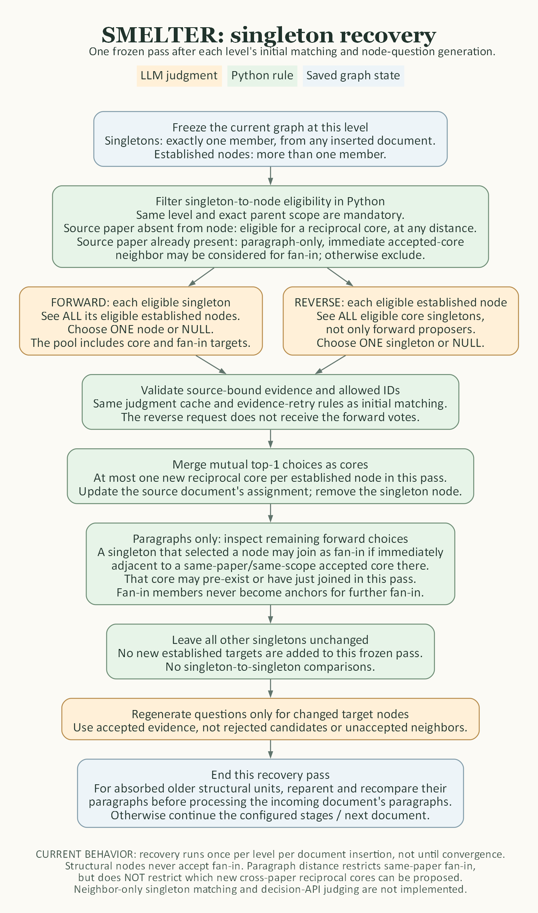
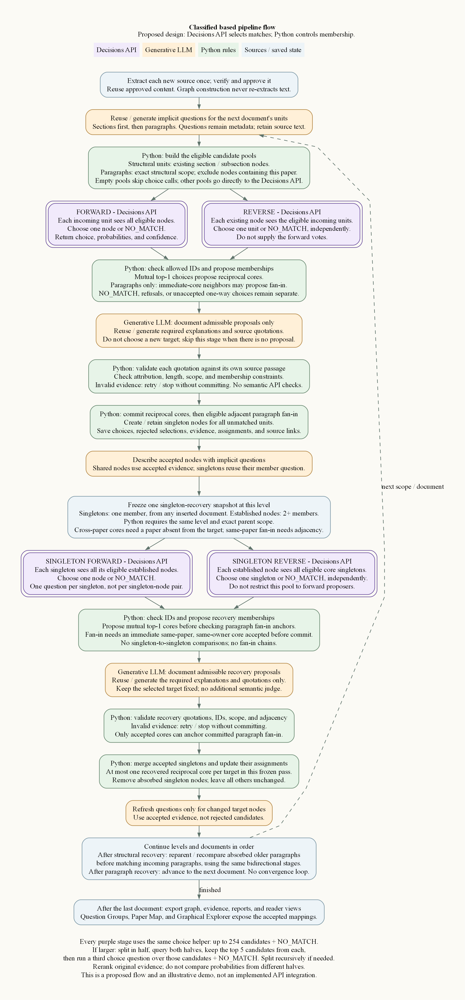

# Pipeline flow

The supported pipeline builds an ordered, question-role graph from canonical
documents. Extraction prepares a new source once; graph construction never
extracts it. Language models make bounded question and match judgments. Python
validates those judgments, applies graph rules, and writes inspectable outputs.
This is an SME-inspired comparison system, not the canonical symbolic SME.

## Implemented Jev flow

Jev selection is available with `start --jev`. The
[detailed diagram](docs/diagrams/jev-pipeline.svg) shows the full run lifecycle,
both matching directions, singleton recovery, oversized-pool selection,
fixed-target evidence, caching, failure recovery, viewer export, and run comparison.
The [Jev guide](docs/jev.md) gives exact startup and minimal-run commands.


Jev chooses candidates through TypeSafe's Choice endpoint. The existing
generative provider writes questions and source-bound evidence; Python retains
all graph rules. Every non-null directional choice gets evidence before
reconciliation, including choices Python ultimately rejects. This preserves
the existing directional-judgment audit contract. Earlier Decisions API plans
are proposals, not the implemented TypeSafe transport described here.

## From source to viewer




`python -m pipeline.extraction` calls the extraction Skill only for new source
bytes, retains the first response, and publishes content with a pending source
review. `python -m pipeline.source_review` checks coverage/order/boundaries and
records approval after original-source review. Newly extracted inputs cannot
pass the validation stage without that approval. Identical sources reuse an
approved copy without another extraction; frozen run inputs retain its receipt.
`python -m pipeline.incremental_graph.cli validate` makes no model calls.
`start` creates a run from at least two documents; `add` appends only new
documents; `retry` takes no manifest and reuses saved inputs. Every execution
writes a new revision and replays the ordered sequence,
reusing completed judgments whose inputs and policy are unchanged. A failed
revision does not replace the last successful one. Viewer build, serving, and
packaging make no model calls.

## One document insertion




Orange stages mix model judgments and deterministic Python reconciliation;
the model is called only when a question is missing or a judgment is not
already in the run cache. Each match request selects one eligible
candidate or null; it does not return a batch of matches. Python accepts
reciprocal selections, applies the limited paragraph adjacency rule, and keeps
unaccepted selections as provenance. Structural singleton recovery can absorb
an older section. The runner then compares that section's existing paragraphs
inside their new shared scope before processing the incoming document's
paragraphs. Paragraph-only mode skips structural model judgments but still
runs paragraph recovery.

See [architecture](docs/architecture.md) for the exact rules and
[data contracts](docs/data-contracts.md) for input and output schemas. The
[README](README.md) gives commands for a first run and a new corpus.

## Current matching decisions

These diagrams describe the maintained working-tree implementation, not the
frozen policies of historical runs. Orange boxes identify model judgments;
green boxes identify deterministic rules. No matching behavior was changed to
make these diagrams.



The initial pass compares one incoming unit against its entire allowed node
pool, then independently compares each node against the incoming unit pool.
For nonempty pools, this is `N + G` logical judgments, not `N * G` pairwise
requests. Caching, native provider steps, and evidence retries affect the actual
API-call count. Sections and subsections are peers; paragraph candidates must
share the exact structural node and cannot already contain the incoming paper.
Empty pools make no match judgments.

Python checks reciprocal top-1 selections and source quotation attribution.
Paragraph-only fan-in additionally permits immediate core neighbors, including
qualifying existing nodes whose members are each adjacent to same-paper target
cores. This is a local membership rule, not a formal global structural
alignment. The shared-role and participant-consistency requirements are model
instructions; no independent semantic verifier checks them. Group-question
generation labels accepted evidence and does not reconsider membership.
Quote-attribution and quote-length failures receive up to two additional
attempts using the same source pool. Other contract failures or exhausted
evidence retries stop the revision; valid cached judgments are revalidated.

## Singleton recovery



Recovery takes one frozen snapshot per level per document insertion. A node
with one member can target an established node with more than one member.
Same-level and exact-parent restrictions apply. Cross-paper core candidates
are not restricted to geographic neighbors. Only same-paper paragraph fan-in
requires immediate adjacency to an accepted core. The reverse pool contains
all eligible core singletons, not just forward proposers. Recovery does not
compare singletons with each other or repeat until convergence.

The implementation is in
[`runner.py`](pipeline/incremental_graph/runner.py),
[`match_rules.py`](pipeline/incremental_graph/match_rules.py),
[`evidence.py`](pipeline/incremental_graph/evidence.py), and
[`judgments.py`](pipeline/incremental_graph/judgments.py).
[`match_evidence.py`](pipeline/incremental_graph/match_evidence.py) owns quote
attribution; [`match-role`](skills/match-role/SKILL.md) owns the bounded semantic
matching instructions.

The editable Graphviz sources live beside the PNGs. Regenerate these two images
with Graphviz installed:

```powershell
dot -Tpng -Gdpi=144 docs/diagrams/matching-current.dot -o docs/diagrams/matching-current.png
dot -Tpng -Gdpi=144 docs/diagrams/singleton-recovery.dot -o docs/diagrams/singleton-recovery.png
```

## Classified based pipeline flow

The proposed design uses the Decisions API for both directions of initial
matching and singleton recovery. Python retains candidate eligibility,
reciprocity, paragraph adjacency, evidence validation, and graph changes.
There is no additional semantic-verification API call or LLM-selector fallback.
This integration is not implemented in the pipeline yet.



Open the [step-by-step demo](docs/demos/decisions-pipeline.html) directly in a
browser. It runs offline with Play/Pause, Back/Next, a step slider, and two
examples: the complete insertion/recovery sequence and an oversized candidate
pool. All documents, probabilities, and choices are scripted examples; the demo
makes no model calls and does not measure matching quality.

The animation keeps one corpus graph on screen. A new paper arrives without
questions, separates into sections and paragraphs, gains implicit questions,
and joins existing nodes through visible choice and reciprocity arrows. Gray
singletons remain in place during recovery. Connections play one at a time,
with highlighted endpoints and Previous/Next arrow controls. The demo hides
background ownership edges during comparisons and waits for the arrow sequence
before advancing in Play mode. The example shows accepted fan-in,
a rejected fan-in chain, wrong-scope exclusion, and a misattributed quotation
that blocks a commit until repaired. Updated node questions visibly broaden
as their accepted evidence changes. The cache/receipt bookkeeping is omitted
from the presentation.

### Bidirectional choice passes

Purple boxes identify choice questions. Initial matching asks each incoming
unit to choose a node, then independently asks each existing node to choose an
incoming unit. Recovery asks each eligible singleton to choose an established
node, then independently asks each established node to choose an eligible core
singleton. Each question includes `NO_MATCH`; Python converts it to `null`.
Reverse questions see all eligible candidates, not only forward proposers, and
do not receive the forward votes. Empty pools make no choice calls.

Python proposes reciprocal cores and the existing immediate-core paragraph
fan-in. A generative LLM still supplies missing questions and the explanations
and quotations required to document admissible proposals. The Decisions API
does not generate that evidence. Python checks each quotation against its own
source passage before committing a proposal. It retries/stops on invalid
evidence rather than storing it. These checks establish attribution and graph
consistency, not semantic correctness.

### Oversized choice pools

The [official OpenAI API reference](https://developers.openai.com/api/reference/resources/decisions/methods/create)
allows 2-255 unique choices and returns a probability for each option. Reserving
one choice for `NO_MATCH` leaves 254 candidate IDs. Each purple block uses the
same internal selection procedure:

1. With 1-254 eligible candidates, ask one choice question over all candidates
   plus `NO_MATCH`.
2. With more than 254 candidates, split the ordered pool into two halves. Query
   each half with the same focus, instructions, source evidence, and `NO_MATCH`.
   Retain up to five candidate IDs from each half's returned probabilities,
   excluding `NO_MATCH` from those five.
3. Ask a third choice question over the combined shortlist and `NO_MATCH`, with
   the original evidence for those candidates. Use its choice for that direction.
   Do not compare probabilities across the two independently normalized halves.

For 255-508 candidates, that is three logical choice questions per focus. If a
half still exceeds 254 candidates, apply the same split recursively and obtain
its top five from its final reranking distribution. The demo uses 300 candidates:
two 150-candidate questions, then a 10-candidate question, each with `NO_MATCH`.
Independent questions may share a request; a reranking question depends on the
earlier results and must follow them. See the
[Decisions guide](https://developers.openai.com/api/docs/guides/decisions).
Shortlisting can discard a candidate that a full-pool comparison would prefer;
this proposal does not guarantee a globally best match.

### Recovery and continuation

Recovery freezes singletons and established nodes once per level per insertion.
It uses the current level/parent and paper restrictions, including paragraph-only
adjacent fan-in. Cross-paper core matching is not neighbor-only. It does not
compare singletons with each other or repeat until convergence. After a structural
singleton joins a node, its older paragraphs move into the shared scope and use
the same forward/reverse stages before the incoming paragraphs. Changed target
nodes get updated questions. The pipeline then advances to the next document
and eventually exports its graph, evidence, and reader views.

The editable source is
[`classified-based-pipeline-flow.dot`](docs/diagrams/classified-based-pipeline-flow.dot).
Regenerate the colored, 12-point Times New Roman figure with:

```powershell
dot -Tpng -Gdpi=216 docs/diagrams/classified-based-pipeline-flow.dot -o docs/diagrams/classified-based-pipeline-flow.png
```
