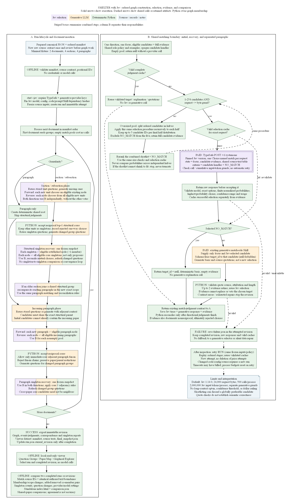
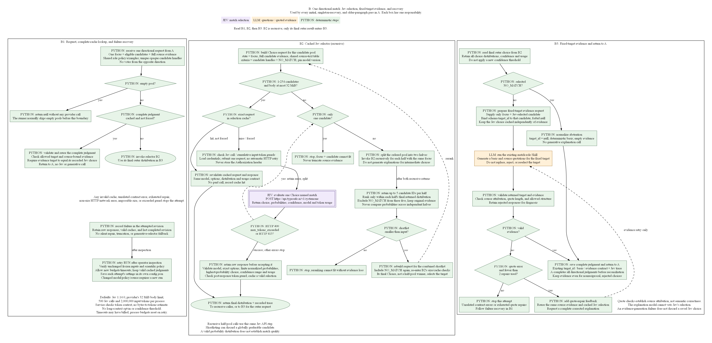

# Run SMELTER with Jev and compare results

Jev selects model-judged matches in initial and singleton-recovery passes, including
paragraphs moved into a new structural scope. Single-paragraph structural matches
inherit their paragraph match without a model call, as described below. Python controls candidate
eligibility, reciprocity, paragraph fan-in, evidence validation, and graph updates.
The existing generative provider still writes missing questions, group questions,
and explanations with source quotations. **A TypeSafe key alone is not enough:
the default Jev run needs both `TYPESAFE_API_KEY` and `ANTHROPIC_API_KEY`.**

The earlier two-paper HCI run is saved locally. The revised prompts and optional
Choice-plus-Noul mode completed a bounded live comparison: all 24 requests across
12 frozen HCI decisions passed. Lossless shared-text encoding resolved the first
probe's context-limit failure. Results were mixed, so Choice remains the default;
Noul still needs a minimal end-to-end live smoke run before scaling. See the
[live comparison report](reports/jev-prompt-comparison-20261025.html).

## Single-paragraph inheritance

When already-matched sections/subsections each consist of exactly one paragraph,
Python matches those paragraphs directly. It makes no paragraph-selection call
to Jev or an LLM and no explanation-generation call. This applies to all selector
modes, including paragraphs revisited after structural recovery.

The shortcut requires one incoming paragraph, one existing paragraph-group
candidate, and each represented source unit's complete structural evidence to
equal its sole paragraph. One candidate alone is not sufficient: a group formed
from multi-paragraph units still requires normal matching. A section with extra
subsection text is not a one-paragraph unit, and a paragraph-only corpus root is
not an established structural match.

The run records both inherited directions with `provider: deterministic`, rule
`single_paragraph_structural_match`, the parent group ID, and validated source
excerpts. Normal graph reconciliation and viewer export remain in place. These
excerpts document inheritance; they are not new model judgments. Question
generation is unchanged. The HCI funding pair now takes this path after its
Acknowledgments sections match, so neither Choice nor Noul can reject it again.

This is a scientific matching-policy change. Start a new run to apply it; existing
saved runs and comparison reports remain unchanged. The frozen-decision comparison
tool replays historical selector requests directly, so it does not exercise this
runner-level shortcut and should not be used to re-test inherited paragraph matches.

## Execution limits are opt-in

New runs have no local cumulative-token, request-count, per-request input-token,
or prompt-character cap. Usage is still recorded. Set a positive limit only when
you want one; omit it or use `null` in a configuration file for no local limit.
The default configuration does not add stage-level input-token caps either.
Old saved runs retain their original settings until explicitly overridden.

Provider-enforced context, request-size and choice-count limits still apply.
The existing `max_tokens` output-generation settings and context-management
settings remain unchanged: they affect model behavior, not cumulative run budgets.
Transport errors and invalid responses still stop execution.

When code changes require a new run, `start --cache-from runs/previous-run`
copies the old cache without changing the old run. Only exact matching request
fingerprints are reused, and cached evidence is validated normally. The new run
records its cache source separately. This avoids buying unchanged decisions again
without rewriting an earlier run's scientific-policy hash.

## Detailed flow

The flow has two separate diagrams. Every step has a single responsibility:
purple for Jev selection, orange for generative LLM work, and green for
deterministic Python steps. No striped or mixed-responsibility boxes remain.

**A. Run lifecycle and document insertion:**
[PNG](diagrams/jev-pipeline.png), [zoomable SVG](diagrams/jev-pipeline.svg),
[Graphviz source](diagrams/jev-pipeline.dot).



Read A's numbered columns in order. They separate question generation, Jev
selection, fixed-target explanations, validation, reconciliation, and recovery.
Named connectors continue execution in another column. Each matching sequence
runs once per directional request before Python reconciles the complete set.

**B. One directional match:**
[PNG](diagrams/jev-matching.png), [zoomable SVG](diagrams/jev-matching.svg),
[Graphviz source](diagrams/jev-matching.dot).



B expands the common matching operation used by all initial, recovery, and
older-paragraph passes in A. Its three columns show complete-cache lookup,
recursive Jev selection, and fixed-target evidence. Unlike the earlier Decisions
API proposal, this implementation calls TypeSafe directly. These diagrams show
the default Choice/NO_MATCH mode. The optional Noul gate described below replaces
the NO_MATCH option inside the Jev selection step; all later steps stay the same.
The runner applies single-paragraph inheritance before entering diagram B;
inherited paragraph matches bypass its selection and explanation steps.

## Directory and setup

Run all commands from **`hypothesis/SME-prototype-elena-clean`**, the nested
repository containing `pipeline/`, `datasets/`, `requirements.txt`, and
`package.json`. Do not run them from the parent `hypothesis` directory or from
inside `pipeline/`. The module is `pipeline.incremental_graph.cli`, including
the final `.cli`.

Use Python 3.11. On macOS, substitute your checkout's location:

```bash
cd "/path/to/hypothesis/SME-prototype-elena-clean"
python3.11 -m venv .venv
source .venv/bin/activate
python -m pip install -r requirements.txt
```

On this Windows checkout, in PowerShell:

```powershell
cd "C:\HBS\Glassman Lab Research\hypothesis\SME-prototype-elena-clean"
py -3.11 -m venv .venv
.\.venv\Scripts\Activate.ps1
python -m pip install -r requirements.txt
```

If you already have the environment, activate it rather than recreating it.
The remaining `python` commands work in either activated environment.

## Credentials

On macOS Terminal (zsh or bash), set keys for this terminal session:

```bash
export TYPESAFE_API_KEY="your-typesafe-key"
export ANTHROPIC_API_KEY="your-anthropic-key"
```

In Windows PowerShell:

```powershell
$env:TYPESAFE_API_KEY = "your-typesafe-key"
$env:ANTHROPIC_API_KEY = "your-anthropic-key"
```

In Windows Command Prompt (`cmd.exe`):

```bat
set "TYPESAFE_API_KEY=your-typesafe-key"
set "ANTHROPIC_API_KEY=your-anthropic-key"
```

Replace the placeholders privately. Literal keys typed into a shell can remain
in its history. Do not paste keys into chat, commit them, or include them in reports.
These assignments affect that shell and its child processes, not other terminals.

Alternatively, keep plain `NAME=value` lines in an untracked `.env`. For each
key, the loader checks the process environment first, then `.env` in the nested
repository root, then each ancestor directory, nearest first. Thus a key in
`hypothesis/.env` can supply this repository if the closer file does not supply
it. This is a small key-value reader, not shell execution: omit `export`, variable
interpolation, and inline comments. `validate` does not load keys. `start --jev`
checks that both required keys exist before creating a run or making paid calls;
that check does not authenticate them with either service.

The default generative configuration remains `claude-sonnet-5`. To use the
existing OpenAI native-Skills route, supply `OPENAI_API_KEY` instead of the
Anthropic key and add `--provider openai --model YOUR_SKILLS_CAPABLE_MODEL` to
`start`. An arbitrary chat model will not work. That route also needs live
verification; Jev always uses the separate TypeSafe key.

## Minimal live Jev run

The fixture contains two synthetic documents with two sections and two paragraphs
each. Stored unit questions avoid unnecessary generation. One pair describes the
same interruption mechanism in different domains; the remaining units have
different roles. These inputs are manually authored, so no extraction is needed.

First validate offline, without keys or network:

```bash
python -m pipeline.incremental_graph.cli validate datasets/jev-smoke/manifest.yaml
```

Expect `water`, then `warning`, each with two sections, two paragraphs, and zero
missing questions. After setting both keys, run:

```bash
python -m pipeline.incremental_graph.cli start datasets/jev-smoke/manifest.yaml runs/jev-smoke-01 --jev --jev-model jev-1.14.0
python -m pipeline.incremental_graph.smoke_check runs/jev-smoke-01
```

**`start` makes paid calls.** It requires a new run directory. Choose
`jev-smoke-02` for a separate experiment; do not delete a prior run to reuse its
name. The pinned Jev version is explicit because TypeSafe's aliases move.
See the [official model list](https://docs.typesafe.ai/models).

The smoke checker makes no API calls. It should print `"passed": true` and exit
zero. Expected memberships at both levels are one shared group containing the
two mechanism units and two singleton groups. A different completed graph is a
failed semantic smoke check, even if the API requests succeeded. The checker
also reports `selector: "jev"` or `"llm"`; verify that the Jev run says `jev`.
Passing this synthetic example does not establish corpus-level accuracy.

### Optional Choice-plus-Noul mode

The default remains `--jev-selection-mode choice`, with `NO_MATCH` as an option.
To test the alternative in a **new** small run:

```bash
python -m pipeline.incremental_graph.cli start datasets/jev-smoke/manifest.yaml runs/jev-smoke-noul-01 --jev --jev-selection-mode choice_noul --jev-model jev-1.14.0
python -m pipeline.incremental_graph.smoke_check runs/jev-smoke-noul-01
```

This makes paid Jev and generative-provider calls. It is an experimental mode,
not a demonstrated quality improvement. TypeSafe recommends testing a companion
[Noul existence question](https://docs.typesafe.ai/primitives/choice) when a
none-of-the-above Choice performs poorly.

For two or more candidates, one HTTP request asks two independent questions:
Choice ranks only real candidates; Noul asks whether any candidate supports a
defensible shared role. Python accepts the Choice only when Noul is greater than
0.5. At or below 0.5, it abstains. This uses the more probable binary answer, with
ties abstaining; it is not a calibrated quality threshold or a match-similarity
score. A single candidate needs only Noul, avoiding an invalid one-option Choice.
Both questions receive the shared semantic policy and examples independently.
Noul controls abstention; the ranking question does not also instruct abstention.

Reciprocity, candidate eligibility, source preparation, questions, and fixed-target
evidence validation are unchanged. Mode and prompt changes invalidate scientific
caches and require a new run. They are not budget-only retry overrides.

The scripted successful test now uses four Jev requests and four generative Skill
invocations: two structural-match explanations and two shared-group questions.
The paragraph pair inherits its structural match, saving two Jev requests and two
explanation invocations compared with the previous implementation. Live
choices can change that count. Native Skill invocations can require multiple API
responses, and evidence repair can add more. Optional `--jev-max-calls` and
`--max-api-responses` flags cap requests/responses separately **per process**
only when supplied. They are not dollar limits. Optional token guards apply
after receiving a response, and a timeout may already have incurred a charge.
Inspect usage before retrying.

## Compare prompts on saved decisions

For a cheaper selector-only test, reuse saved Jev requests rather than rebuilding
the graph. This command needs only `TYPESAFE_API_KEY` when `--live` is present;
it never calls Claude or changes the source run. Without `--live`, it makes no
network calls and writes an inspectable plan:

```bash
python -m pipeline.jev_prompt_comparison runs/hci-first-two-jev-20261025-01/revisions/revision-0002 --cases datasets/jev-smoke/hci-prompt-cases.json --out output/jev-prompt-comparison/hci-20261025-corrected
```

The case file explicitly selects 12 attempts before seeing new results. Each
case keeps the original sources, generated questions, complete candidate pool,
order, and model. The tool checks a lossless source-encoding round trip and the
original request fingerprint. It compares cleaned Choice against cleaned
Choice-plus-Noul, retaining the saved legacy answer without buying it again.
This is a directional decision comparison, not a new graph or an accuracy score.

To authorize the bounded live comparison, add `--live`:

```bash
python -m pipeline.jev_prompt_comparison runs/hci-first-two-jev-20261025-01/revisions/revision-0002 --cases datasets/jev-smoke/hci-prompt-cases.json --out output/jev-prompt-comparison/hci-20261025-corrected --live --max-calls 24 --max-input-tokens 500000
```

The call guard spans both modes. The token guard uses reported usage after each
response, so it can overshoot by one response; it is not a hard dollar cap.
Any transport, validation, or size error stops the experiment. It does not split
the frozen candidate pools, retry HTTP requests, truncate evidence, or substitute
another provider. Inspect a failure before running again.

`plan.json` contains exact proposed requests. `comparison.json` records original
and new selections, Noul probabilities, usage, and elapsed selector-call time.
`cache/` preserves exact requests and responses. A repeat with unchanged prompts
reuses valid caches and retains the first measured latency. Changing a prompt or
case list requires a new output directory. API behavior remains probabilistic;
the case selection, source decoding, cache checks, and reporting are deterministic.

The [October 25 live report](reports/jev-prompt-comparison-20261025.html) records the
completed 24-call comparison and result checks. Cleaned Choice selected 7/12
directions and Noul 8/12, versus 6/12 in the saved legacy answers; these are not
accuracy scores. Choice recovered reciprocal funding selection, while Noul did
not. Noul remains opt-in. The corrected output directory now contains completed
results; repeating the command unchanged reuses caches, not a fresh sample.
The [earlier stopped experiment](reports/jev-prompt-update-20261025.html) remains
in `output/jev-prompt-comparison/hci-20261025`; do not overwrite it.

## View the result

With Node.js 22 installed, build the existing viewer once:

```bash
npm ci
npm run build:viewer
python -m pipeline.viewer.server runs --port 8073
```

Open `http://127.0.0.1:8073/`, select `jev-smoke-01`, then its completed revision.
Use Question Groups for memberships and quotations, Paper Map for the individual
documents, or Graphical Explorer for the layout. Two documents are sufficient.
Keep the server terminal open; Ctrl+C stops it. The viewer makes no model calls
and exposes the exported dataset rather than credentials or private caches.

## Compare runs

The comparison command reads completed exports and creates a standalone HTML
report plus machine-readable JSON. It requires neither API keys nor a web server.
For a baseline using the original generative selector, omit `--jev`:

```bash
python -m pipeline.incremental_graph.cli start datasets/jev-smoke/manifest.yaml runs/llm-smoke-01
python -m pipeline.incremental_graph.compare runs/llm-smoke-01 runs/jev-smoke-01 output/comparisons/llm-vs-jev-smoke-01
```

Only the first command makes paid calls. Open
`output/comparisons/llm-vs-jev-smoke-01/index.html` in a browser. On macOS:

```bash
open output/comparisons/llm-vs-jev-smoke-01/index.html
```

On PowerShell, use
`Start-Process output/comparisons/llm-vs-jev-smoke-01/index.html`.
The output directory must be new; the command never overwrites an older report.

You can compare any compatible existing runs, two Jev configurations, or explicit
completed revision directories instead:

```bash
python -m pipeline.incremental_graph.compare runs/hci-section-medium-excerpts-20260917/revisions/revision-0008 runs/hci-section-medium-excerpts-20260917/revisions/revision-0013 output/comparisons/hci-0008-vs-0013
```

That historical example assumes those local runs are present. A run-directory
argument selects its last completed revision, even if the latest attempt failed.
The tool deliberately permits different historical policies; it does not require
the old run's code hash to match today's checkout.

The Python comparison is deterministic and makes no model, embedding, or API
calls. It uses the existing pinned NetworkX dependency. The HTML report includes:

- **Passage diff:** each source passage sits above baseline/comparison columns.
  Red marks removed partners, green marks added partners, and neutral cards mark
  retained partners. Colors describe changes, not correctness. Expand a passage
  to read its full text, or inspect both group questions below the matches.
- **Review controls:** switch between paragraphs and structural units, filter by
  paper or change type, and search passages, partner text, source IDs, or questions.
  The source index jumps directly to a passage. Parent-scope-only changes have a
  separate filter; they do not count as changed paragraph memberships. Each card
  shows one source's perspective, so a pair can appear in both papers' cards;
  the summary counts each cross-paper pair once.

- **Coverage:** the fraction of shared source units with at least one match in
  another paper, overall and per paper. Singleton units remain in the denominator.
- **Match similarity:** cross-paper pair Jaccard (intersection / union), pair F1
  agreement, baseline-pair retention, and each active unit's peer-set Jaccard.
  Same-paper fan-in pairs do not inflate these scores. Units unmatched in both
  runs do not inflate peer agreement.
- **Graph comparison:** NetworkX intersection and symmetric difference provide
  retained edges and exact edge edits with source identities fixed. Isomorphism
  also preserves source IDs, so similarly shaped but unrelated matches do not
  count as equivalent.
- **Group alignment:** NetworkX `max_weight_matching` finds a global one-to-one
  alignment maximizing shared-member counts, without using question wording.
  Unaligned groups count as zero in mean membership Jaccard. Overlap counts expose
  possible splits and merges; this alignment does not prove semantic equivalence.
- **Question similarity:** normalized exact agreement, token-set Jaccard, and
  TF-IDF cosine for source-unit questions and aligned cross-paper group questions.
  These measure wording, not meaning. TF-IDF uses raw token counts and smoothed
  IDF fitted separately on each comparison's nonempty question pairs; scores from
  different comparison corpora are not calibrated. Missing questions are excluded.
- **Review details:** added/lost pairs with source passages, aligned group
  questions, unit-question changes, and membership changes separated from
  parent-scope-only changes. `comparison.json` contains the complete metric data.

Comparisons ignore generated group IDs. By default, shared papers must have the
same source IDs, authored text, and boundaries, and both runs must use the same
granularity. To inspect historical runs with different section/subsection
projections, explicitly opt into the shared-source intersection:

```bash
python -m pipeline.incremental_graph.compare runs/hci-section-medium-excerpts-20260917/revisions/revision-0004 runs/hci-first-two-jev-20261025-01 output/comparisons/hci-two-paper-shared --shared-sources
```

This mode still rejects changed text for a common source ID. It reports excluded
units and metadata differences rather than silently treating different boundaries
as identical. Coverage and graph scores use only the shared-source intersection;
full-run counts remain separate. Extra papers and full parent scopes can influence
the results even after projection. Older revisions without `config.json` use
`run.json` as a clearly flagged, potentially stale settings fallback.

No cross-paper pairs in either result means agreement is not applicable, not
perfect. Integer alignment weights and canonical source ordering make results
repeatable with the pinned NetworkX version. We do not use unrestricted graph edit
distance: remapping known source identities would obscure which passages matched,
and timeout-bounded searches would make the result depend on execution time.

Neither run is ground truth: agreement measures consistency, not accuracy or causality.
Keep source preparation, order, granularity, and generative settings constant
when testing the effect of Jev alone. Human labels are needed to establish whether
added matches are correct and whether removed matches are genuine improvements.

### Publish a saved comparison

The HTML embeds its data, styles, and browser code. It works locally without a
server and can be hosted as a static site alongside `comparison.json`. Add
`--public` to omit local filesystem paths; this still publishes source passages,
questions, memberships, and model settings, so review the inputs before sharing.
No API credentials, provider caches, or run directories need to be uploaded.

The Jev-versus-LLM demo uses the same two papers and subsection granularity:

```bash
python -m pipeline.incremental_graph.compare runs/hci-concise-fresh-20260907/revisions/revision-0001 runs/hci-first-two-jev-uncapped-20261025-01/revisions/revision-0001 output/comparisons/llm-vs-jev-review --public
vercel link --yes --project smelter-run-comparison --scope kanishk-tantias-projects --cwd output/comparisons/llm-vs-jev-review
vercel deploy --prod --cwd output/comparisons/llm-vs-jev-review
```

These historical runs differ in prompts, questions, and model settings. The
comparison is not a controlled test of Jev's accuracy. The failed three-paper
attempt is not included. Use a new output directory when generating another
comparison; deployment replaces only this demo, not the existing manual matcher.

The display lives in `pipeline/comparison_viewer/`; Python still computes all
comparison metrics. Run its focused checks with `node --test
tests/comparison-viewer.test.mjs` and `python -m unittest discover -s tests -p
test_run_comparison.py -q`.

## Run a real corpus

Use existing canonical JSON and an ordered manifest. For new raw documents, follow
the [source preparation and review instructions](../README.md#run-your-own-documents)
before graph construction. Inspect the offline unit counts first:

```bash
python -m pipeline.incremental_graph.cli validate datasets/my-corpus/manifest.yaml
python -m pipeline.incremental_graph.cli start datasets/my-corpus/manifest.yaml runs/my-corpus-jev --jev --jev-model jev-1.14.0
```

This command has no local spending or token cap. The prepared two-paper HCI example has 66 structural units and 221
paragraphs; it is much larger than this smoke test. Review counts and account
limits before starting it. Earlier run costs do not establish the cost or accuracy
of the revised prompts and optional Noul mode.

To extend a successful run, use a manifest containing only new papers:

```bash
python -m pipeline.incremental_graph.cli add datasets/my-corpus/new.manifest.yaml runs/my-corpus-jev
```

`add` and plain `retry` retain the last saved configuration. Retry can override
execution guards and timeouts without changing scientific policy or invalidating
cached results. Models, generation settings, prompts, matching code, dependencies,
and source data remain fixed. Do not edit `run.json` or frozen inputs.

## Recover a failed attempt

1. Read `run.json` to identify `latest_revision` and `current_revision`. Inspect
   `revisions/<latest_revision>/failure.json`. A killed process may not have written
   that file; also inspect the terminal error and saved responses. Preserve the
   entire run directory.
2. For missing credentials, set the appropriate environment variable. For an
   authentication, rate-limit, or service error, fix the account issue or wait
   for service recovery. Inspect provider usage before another paid attempt.
3. With unchanged inputs and policy, retry the run:

```bash
python -m pipeline.incremental_graph.cli retry runs/jev-smoke-01
```

If an explicitly configured budget stopped the attempt, review usage. To remove
it, supply a copy of the saved config with its execution-limit fields set to `null`.
To keep a cap but change its allowance, supply explicit flags instead:

```bash
python -m pipeline.incremental_graph.cli retry runs/jev-smoke-01 --jev-max-calls 12 --max-api-responses 40
```

These flags change only the next process's guards, not the choices or cache keys.
The example allowances suit the small smoke fixture, not a cost estimate for HCI.
For other guards or Jev's timeout, supply a full pipeline YAML/JSON configuration:

```bash
python -m pipeline.incremental_graph.cli retry runs/jev-smoke-01 --config path/to/retry-config.json
```

Each revision's `config.json` records its complete resolved configuration. Use
those settings in a separate retry config and change only:

- `jev.max_calls`, `jev.max_input_tokens`, or `jev.timeout_seconds`.
- `model.max_api_responses_per_process`, `model.max_session_input_tokens`,
  `model.max_session_output_tokens`, `model.max_input_tokens`, or
  `model.max_prompt_characters`.
- A stage's `max_input_tokens` guard.

The CLI flags take precedence over the supplied file. Unspecified overrides keep
the saved values. Each new attempt saves its overrides for later attempts.
`max_tokens` is **not** a budget-only setting: it limits generated output and stays
part of scientific policy, along with model identity, effort, thinking, and context
management. A changed scientific setting fails before any provider call or new
revision. Comparison reads each revision's own configuration, not the latest limits.

Retry writes a new revision and replays the ordered stages, reusing valid saved
judgments. A saved Jev choice survives an evidence-generation failure, so an
ordinary retry need not buy that choice again. Failed attempts do not replace
the last completed revision. This is cached replay, not resuming a Python stack.

Jev HTTP failures other than explicit size rejections, malformed responses,
impossible request sizes, and exhausted evidence repairs stop the attempt.
There is no silent generative-selector fallback.
If a request times out without a saved valid response, retry may repeat a paid
request; the pipeline cannot prove the service did not bill it. Do not repeatedly
retry an unchanged contract or size error. Inspect the retained response and fix
the underlying issue in a new run if it requires a policy change. Do not delete
caches to bypass validation. Avoid `retry --stage` / `--paper-index` unless you
intend to force judgments and potentially pay again.

Runs created before these request, prompt, and fingerprint corrections retain their
original policy identity. They remain viewable and comparable; retry them using
their original code, or start a new run under this corrected policy. Do not rewrite
old policy hashes to bypass that distinction.

## Selection, evidence, and saved artifacts

The transport calls [TypeSafe System One](https://docs.typesafe.ai/api/system-one)
with one named Choice question per request in default mode. Each pool contains
eligible candidate handles plus `NO_MATCH`. The optional `choice_noul` mode uses
the separate existence question described above. It records the selected option,
distribution, confidence, Noul answer when requested, model, and token usage.
The response must satisfy the
[Choice contract](https://docs.typesafe.ai/primitives/choice); probabilities and
confidence do not become a new acceptance threshold.

Jev reuses the role-selection policy and cross-paper group policy used by Claude.
It derives the same six example lessons from the canonical examples, excluding
Claude's output-JSON and quotation-generation instructions. Candidate criteria
include the existing question metadata and reference a record named by candidate
handle, rather than an array index. Questions remain fallible metadata, not
substitutes for the source. Repeated passages still use the existing lossless
`source_texts` table: all text remains available in order, with no truncation.
The complete judgment cache now also fingerprints the exact Jev request.

Rounded probabilities must total more than 0.98 and at most 1.02. Every value
must still be finite and within 0-1. Selection uses the highest returned
probability, even if Jev's `choice` field names a lower-probability option. On a
tie, keep Jev's choice if it is tied for highest; otherwise use the
lexicographically first tied option ID. This makes tie-breaking deterministic.
The pipeline preserves the raw response and probabilities without rewriting or
renormalizing them. Each affected selection-call trace records a
`choice_correction` with the reported and effective choices. `NO_MATCH` can still
win, and the optional Noul gate still controls acceptance in `choice_noul` mode.

There is no local 24,000-byte cap or bytes-to-tokens estimate. The local body check
uses TypeSafe's documented [32 MiB transport limit](https://docs.typesafe.ai/api/errors).
Within that limit and 254 candidates (255 in Noul mode), the selector sends the full request first.
The service enforces its [token context limits](https://docs.typesafe.ai/models).
Only an explicit HTTP 400 `max_tokens_exceeded` or HTTP 413 size rejection triggers
size-based splitting; unrelated errors stop rather than causing more calls.

Too many candidates or a real size limit triggers recursive half-pool selection,
up to five retained candidate IDs from each half, then reranking in the configured
mode. In Noul mode, an abstaining half still contributes its ranked candidates;
the final combined pool receives a fresh existence judgment.
Probabilities are only ranked within their own response distribution. A single
oversized candidate or an unshrinkable reranking pool stops the run. The
implementation never truncates source text or opts into long context. Shortlisting
can discard a candidate that a full-pool comparison would prefer. Rejected HTTP
requests count toward the call guard, and their response bodies are retained.

For every non-null directional choice, the existing generative Skill receives
only the chosen target and must return that same target with a basis and source
quotations. This happens before reciprocal reconciliation, preserving evidence
for rejected one-way choices too. Quote errors allow two repair attempts without
changing Jev's selection. Abstention uses a deterministic basis and empty evidence,
with no generative call. Attribution checks do not independently establish the
semantic correctness of a match; the explanation model cannot veto the choice.

Within `runs/<name>/`:

| Location                              | Purpose                                                                        |
| ------------------------------------- | ------------------------------------------------------------------------------ |
| `run.json`                            | Latest execution configuration, scientific policy identity, revision pointers |
| `inputs/`                             | Frozen prepared source documents and manifest                                  |
| `cache/jev/<hash>.json`               | Exact Jev request and validated selection, independent of generated evidence   |
| `cache/jev/responses/`                | Raw response records, including responses rejected by validation               |
| `cache/<hash>.json`                   | Complete validated questions/matches, Jev traces, and generated evidence       |
| `cache/responses/`, `cache/rejected/` | Generative responses and rejected evidence for diagnosis                       |
| `revisions/revision-XXXX/`            | Attempt outputs; completed attempts include reports and `dataset/`             |
| `revisions/revision-XXXX/config.json` | Full configuration used for that attempt, including its budgets and timeout    |

These records contain source text, so treat them as research data. The integration
does not save authorization headers or keys. Back up the full run, not only its
viewer export, if you need cached recovery.

Advanced configuration can add a `jev` mapping to a copy of
`pipeline/incremental_graph/configs/incremental-v1.yaml`, keeping that copy in
the same directory so relative policy paths stay correct. Use `--config` with it.
Supported fields are `model`, `selection_mode`, `max_calls`, `max_input_tokens`, and
`timeout_seconds`. Defaults are `jev-1.14.0`, `choice`, `null`, `null`, and 120 respectively.
A configured `jev` mapping also enables Jev without the flag. Remove the obsolete
`max_request_bytes` field from older custom configuration files.

## Offline checks and outstanding live verification

Install the development dependencies and build the viewer contract before tests:

```bash
python -m pip install -r requirements-dev.txt
npm ci
npm run build:viewer
python -m unittest discover -s tests -p "test_jev*.py" -v
python -m unittest discover -s tests -p test_run_comparison.py -v
python -m unittest discover -s tests -p test_comparison_metrics.py -v
python -m unittest discover -s tests -q
```

All these tests use fixtures and mocked transports, with no paid API calls. They
cover Jev request/response validation, NO_MATCH, oversized pools, guards, caching,
fixed-target evidence, complete smoke orchestration, viewer export, failure/retry,
and membership-based comparisons. Existing graph tests cover reciprocal, recovery,
adjacency, and reparenting rules. They do not establish real model behavior.

The bounded live decision comparison now verifies Choice and Noul requests and
responses on 12 saved HCI cases. Before scaling the optional mode, complete its
minimal live smoke run through evidence generation, reconciliation, and export.
Inspect memberships and quotations before running the corpus again. Human
source-by-source evaluation is still necessary to assess whether either model
makes useful correspondences; the unlabeled comparison does not establish accuracy.

Regenerate both diagrams with Graphviz installed:

```bash
dot -Tsvg docs/diagrams/jev-pipeline.dot -o docs/diagrams/jev-pipeline.svg
dot -Tpng -Gdpi=144 docs/diagrams/jev-pipeline.dot -o docs/diagrams/jev-pipeline.png
dot -Tsvg docs/diagrams/jev-matching.dot -o docs/diagrams/jev-matching.svg
dot -Tpng -Gdpi=144 docs/diagrams/jev-matching.dot -o docs/diagrams/jev-matching.png
```
