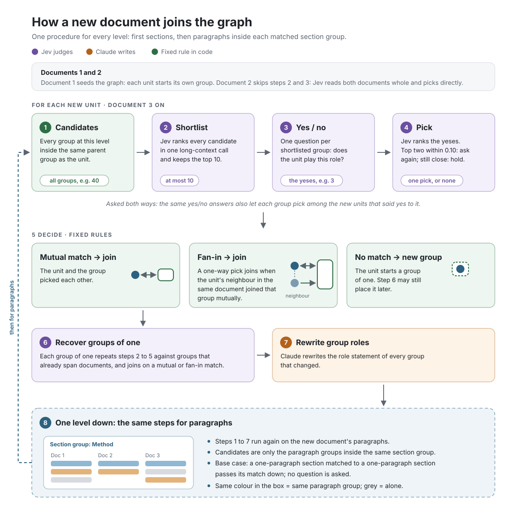

# How matching works

SMELTER builds a graph of **groups**. A group holds units (sections or paragraphs) from
different documents that play the same role. Documents are added one at a time, and
every new document goes through the same steps. Those steps run once for sections, then
again for paragraphs inside each section group.



## Terms

- **Unit:** one section or one paragraph of a document.
- **Role statement:** one sentence on what a unit does for its document. Claude writes
  these before matching (`python -m pipeline.prepare_roles <manifest> <output>`).
- **Group:** units from different documents with the same role. A group has its own role
  statement, which Claude rewrites when its members change.

## The steps for each new document

**Documents 1 and 2 are special.**
- **Document 1:** each unit starts its own group.
- **Document 2:** Jev reads both documents whole and picks directly, so steps 2 and 3 are
  skipped.

**From document 3 on**, each new unit goes through these steps:

1. **Candidates:** every group at the same level with the same parent. For sections the
   parent is the whole graph. For paragraphs it is the section group.
2. **Shortlist:** if there are more than 10 candidates, one long-context Jev ranking
   keeps the top 10.
3. **Yes / no:** one Jev question per shortlisted group: does the unit play this role?
4. **Pick:** Jev ranks the groups that got a yes. If the top two scores are within 0.10,
   Jev is asked again among just those groups. If they are still that close, the unit
   is held back for step 6.
   - **Reverse pick:** the same yes/no answers work in reverse. Each group picks among
     the new units that said yes to it.
5. **Decide** (fixed rules in code):
   - **Mutual match:** the unit and the group picked each other, so the unit joins.
   - **Fan-in:** the unit's pick was one-way. It still joins when its neighbour in the
     same document joined that group through a mutual match.
   - **Otherwise:** the unit starts a group of one.
6. **Recover groups of one:** each group of one repeats steps 2 to 5 against groups
   that already span documents.
7. **Rewrite group roles:** Claude rewrites the role statement of every group that
   changed.
8. **One level down:** for each section group the new document joined, steps 1 to 7
   run on its paragraphs.
   - **Base case:** a one-paragraph section matched to another one-paragraph section
     passes its match down to the paragraph, without asking Jev.
   - **Re-matching:** when fan-in moves an older section to another group, its
     paragraphs are re-matched there.

## Settings

| Setting | Default | Meaning |
|---|---|---|
| `--shortlist N` | 10 | Yes/no questions go only to a unit's top N candidates. `0` asks every pair. |
| `--no-fan-in` | fan-in on | Keep only mutual matches, at both levels. |
| `--close-call-margin M` | 0.10 | Re-ask, then hold, when the top two are within M. `0` always takes the top option. |

Long context (262k tokens) is always on, so Jev always sees each paper whole.

## Cost per new document

Each new unit costs at most about 12 Jev calls: one shortlist ranking, up to 10 yes/no
questions, and one final ranking. That holds however many groups the graph already has,
so the cost of a document grows mainly with its own length, not with the size of the graph.
Without the shortlist, every unit is asked about every group, and the cost of each
document keeps growing as documents are added.

On HCI paper 3 (a median of 27 candidates per paragraph), a shortlist of 8 kept the
final pick 53 times out of 54 and used 996 Jev calls instead of 2,341. A shortlist of
10 should keep the pick at least as often.

## Run it

```bash
python -m pipeline.incremental_graph.cli start <manifest.yaml> runs/<name> --jev
```

Add `--sections-only` to stop after section matching. The detailed flow, including
every journal event, is in [PIPELINE_FLOW.md](../../PIPELINE_FLOW.md), and the Jev
guide is [docs/jev.md](../jev.md).

To redraw the diagram, run `python docs/diagrams/matching-process.py
docs/diagrams/matching-process.svg`.
